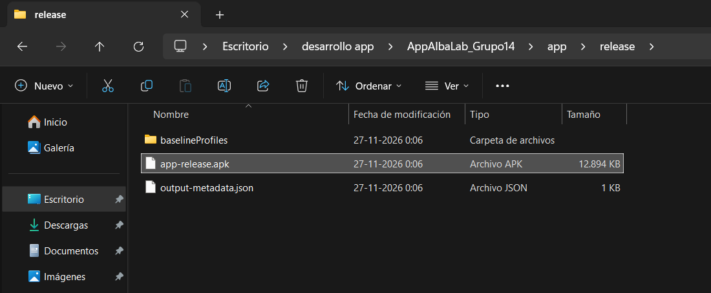

# AppAlbaLab_Grupo14 — Alba Lab (CORPALIV)

Proyecto de la asignatura **DSY1105 — Desarrollo de Aplicaciones Móviles** (Evaluación Parcial 4).

---

## 1. Nombre del Proyecto
**AppAlbaLab_Grupo14** — **Alba Lab (CORPALIV)**: Aplicación móvil Android en Jetpack Compose conectada a microservicio propio Spring Boot para vinculación sociolaboral, tienda solidaria, indicadores económicos en tiempo real, noticias institucionales y gestión CRUD de solicitudes.

---

## 2. Integrantes (Grupo 14)
- **Cristóbal Gabriel Moya Flores**
- **Virgilio Exequiel Herrera Jara**

### Planificación (Trello)
- Tablero del equipo: https://trello.com/b/kVOrf9cf/dsy1105-alba-lab-grupo-14

---

## 3. Funcionalidades Principales y Arquitectura
- **Arquitectura MVVM limpia:** flujo unidireccional y desacoplado `RetrofitClient -> SolicitudApiService -> SolicitudesRepository -> SolicitudesViewModel -> Screens` sin inyectores externos complejos.
- **Control de Acceso por Roles (`INVITADO` / `ADMINISTRADOR`):**
  - `INVITADO`: acceso a Inicio adaptable, Tienda Solidaria, Noticias oficiales de CORPALIV, formularios de contacto y Simulador de Impacto Social.
  - `ADMINISTRADOR`: acceso protegido al **Panel Institucional (`ProfileScreen`)** con gestión CRUD completa (si un invitado intenta acceder, `MainViewModel` y `MainActivity` redirigen automáticamente a `Screen.Noticias`).
- **Pantallas Implementadas:**
  - `LoginScreen`: inicio de sesión validado con persistencia en `SharedPreferences` y acceso directo como invitado/donante.
  - `HomeScreen` (`Compacta`, `Mediana`, `Expandida`): diseño responsive con `WindowSizeClass` y banner diario de la UF chilena (`mindicador.cl`).
  - `CatalogoScreen`: Tienda Solidaria en cuadrícula de 2 columnas con búsqueda validada, filtros por categoría y hoja modal de detalle (`ModalBottomSheet`).
  - `NoticiasScreen`: consumo REST de publicaciones oficiales de CORPALIV con estados `Cargando`, `Exito`, `Vacio` y `Error`.
  - `ContactoEmpresaScreen`, `ContactoCompraScreen` y `ContactoVoluntariadoScreen`: formularios validados con recursos nativos de **Cámara** y **Galería**.
  - `ProfileScreen`: Panel Institucional con filtros por canal, contadores estadísticos, diagnóstico rápido de red y acciones CRUD (`GET`, `POST`, `PUT`, `DELETE`).
  - `SettingsScreen`: gestión de sesión, vaciado administrativo de historial y **Simulador de Impacto Social**.
- **Persistencia Híbrida (Room SQLite + Spring Boot):** almacenamiento local en Room con sincronización hacia `alba-lab-api`, respaldo offline automático si el servidor no responde y subida automática (`POST`) de solicitudes pendientes (`remoteId == null`) al reconectar.
- **Optimizaciones de Rendimiento en Jetpack Compose:** modelos y estados anotados con `@Immutable`, decodificación asíncrona de imágenes en `Dispatchers.IO` con downsampling (`inSampleSize`) y caché `LruCache`, recurso `logo.png` optimizado en `drawable-nodpi`, aislamiento de recomposiciones en `NavHost`/formularios, `key` y `contentType` en `LazyColumn`/`LazyVerticalGrid`, animaciones en fase de dibujo (`graphicsLayer`) y aceleración por hardware (`android:hardwareAccelerated="true"`).

---

## 4. Endpoints Utilizados

### A) APIs Externas (Consumo vía Retrofit)
- **`https://corpaliv.cl/`**
  - `GET /wp-json/wp/v2/posts?per_page=10&_embed=true` → Obtiene las últimas publicaciones oficiales de la corporación CORPALIV.
- **`https://mindicador.cl/`**
  - `GET /api/uf` → Obtiene el valor diario oficial de la Unidad de Fomento (UF) en Chile para el banner del Inicio.

### B) Microservicio Propio Spring Boot (`alba-lab-api`, puerto `8080`, JPA/H2)
- `GET /api/solicitudes` → Lista todas las solicitudes almacenadas en el servidor.
- `POST /api/solicitudes` → Crea una nueva solicitud enviada desde los formularios de la app móvil.
- `PUT /api/solicitudes/{id}` → Actualiza el detalle/observaciones o alterna el estado (`PENDIENTE` / `ATENDIDA`).
- `DELETE /api/solicitudes/{id}` → Elimina una solicitud específica por su identificador remoto.

---

## 5. Pasos para Ejecutar y Probar

### 1. Iniciar el microservicio Spring Boot (`alba-lab-api`)
Desde una terminal PowerShell en la carpeta `alba-lab-api`:
```powershell
cd alba-lab-api
.\mvnw.cmd spring-boot:run
```
*(También puede ejecutarse directamente la clase principal `AlbaLabApiApplication.java` desde IntelliJ IDEA o VS Code; inicia en `http://localhost:8080` con base de datos H2).*

### 2. Conectar el emulador Android mediante túnel ADB
Con el emulador Android encendido (API 24 o superior), activar el túnel reverso para que `http://127.0.0.1:8080/` (`ALBA_LAB_BASE_URL` en `RetrofitClient.kt`) apunte directamente al microservicio local del PC:
```powershell
Set-Location "$env:LOCALAPPDATA\Android\Sdk\platform-tools"
./adb.exe devices
./adb.exe reverse tcp:8080 tcp:8080
```
*(Sin túnel ADB, `RetrofitClient.kt` puede apuntar a `http://10.0.2.2:8080/` en emulador o a la IP local del PC en dispositivo físico).*

### 3. Ejecutar la aplicación Android
1. Abrir `AppAlbaLab_Grupo14` en Android Studio y presionar **Sync Now**.
2. Ejecutar el módulo `:app` en el emulador o dispositivo conectado.
3. Credenciales de demostración para el Panel Institucional (`ADMINISTRADOR`):
   - **Correo:** `admin@corpaliv.cl`
   - **Contraseña:** `albalab2026`

### 4. Ejecutar pruebas unitarias y de UI (carpetas separadas)
- **Pruebas unitarias (`app/src/test`) — 35/35 en verde** (JUnit, MockK y `kotlinx-coroutines-test`: `ExampleUnitTest`, `ValidadoresTest`, `ViewModelsYRepositoriosTest`, `IndicadorViewModelTest`, `MainViewModelTest` y `SolicitudesRepositoryTest`):
  ```powershell
  .\gradlew.bat testDebugUnitTest
  ```
- **Pruebas instrumentadas de UI (`app/src/androidTest`) — 4/4 en verde** (`AlbaLabUiTest` con `createComposeRule()` para `LoginScreen`, `CatalogoScreen` y `SolicitudCard`, más `ExampleInstrumentedTest`):
  ```powershell
  .\gradlew.bat connectedDebugAndroidTest
  ```

---

## 6. Captura del APK Firmado y Keystore (`.jks`)



- **Ejecutable firmado incluido en el repositorio:** `app/release/app-release.apk` (12.59 MB).
- **Alias de firma utilizado:** `albalab-key`.
- **Configuración de compilación `release` (`app/build.gradle.kts`):** empaquetado sin ofuscación/R8 (`optimization { enable = false }`) para preservar la serialización de DTOs en Retrofit y Gson.
- **Nota de seguridad sobre Keystore:** siguiendo las indicaciones del docente y buenas prácticas de seguridad, el archivo `albalab-release.jks` y sus contraseñas se resguardan fuera del repositorio público y están explícitamente bloqueados en `.gitignore`.
